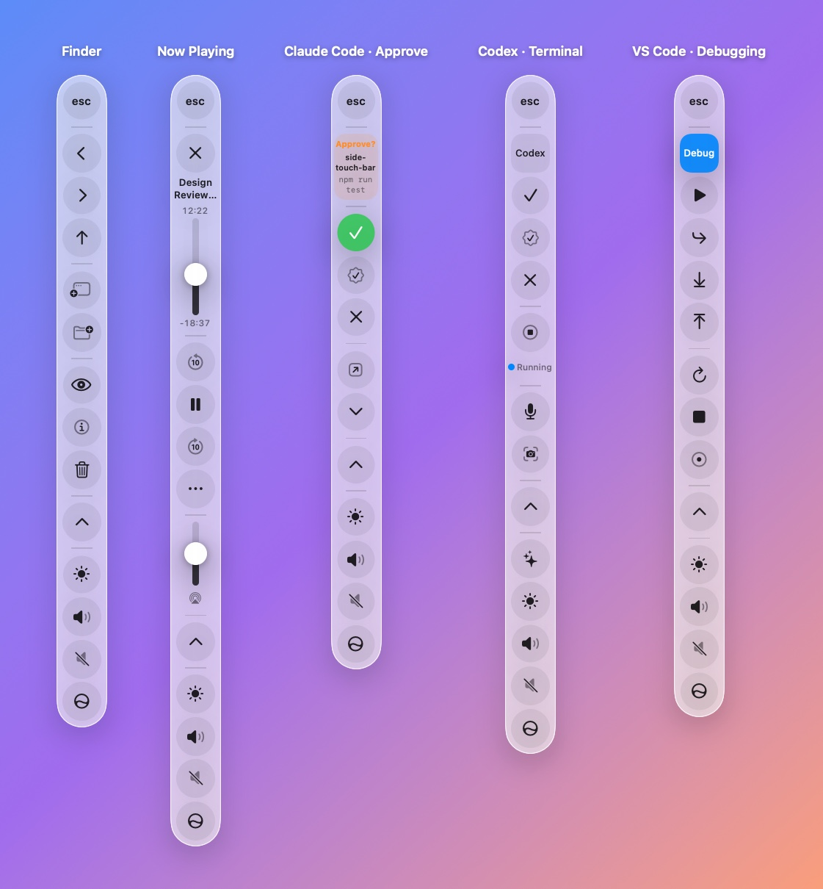
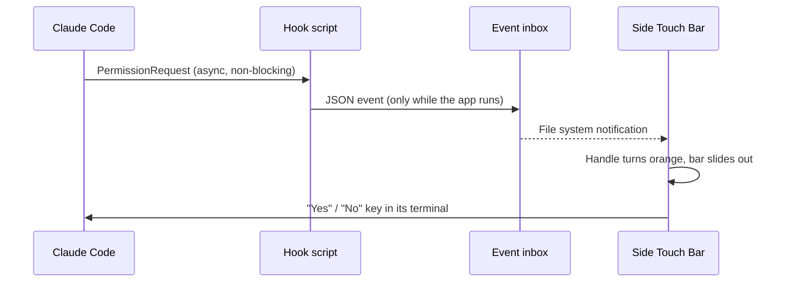
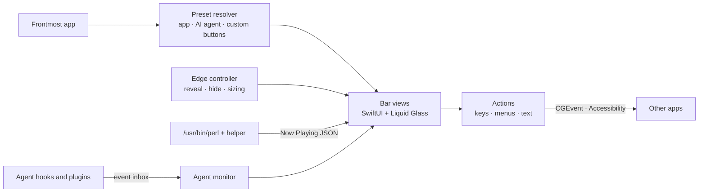

<div align="center">

# Side Touch Bar

**The MacBook Touch Bar, reimagined as a vertical Liquid Glass bar on the edge of your screen.**

Built for the new MacBook Pro with Touch — and fully usable with a mouse or trackpad.

[](https://github.com/TwilightVoyager777/side-touch-bar/actions/workflows/ci.yml)
[](https://github.com/TwilightVoyager777/side-touch-bar/releases)


[](LICENSE)

[Install](#installation) · [Features](#features) · [How it works](#how-it-works) · [FAQ](#faq) · [简体中文](README.zh-CN.md)

<picture>
  <source media="(prefers-color-scheme: dark)" srcset="docs/images/preview-dark.jpg">
  
</picture>

<sub>Rendered from the app's own SwiftUI views; the Liquid Glass material is approximated in these images.</sub>

</div>

---

## Why

The new MacBook Pro finally has Touch. The Touch Bar didn't come back with it.

Before you had time to miss it, it found a new place.

**Touch doesn't stop at the middle of the screen.**

Side Touch Bar stands the Touch Bar up along the right edge of the display: **esc, app controls and the Control Strip**, top to bottom. Rest your fingers behind the lid, and it's right under your thumb. It stays clear of the keyboard, keeps the display steady, and takes no vertical space at all.

Slide to set brightness. Tap to approve Claude Code. Music, video and code each get buttons of their own.

**Touch, taken to the edge.**

## Highlights

- **A faithful Touch Bar** — Control Strip, app controls, F-keys on fn, the original display modes and customization.
- **Context-aware buttons** for browsers, IDEs, terminals, Apple apps — and custom buttons for anything else.
- **Playback controls in one style for every app**, from YouTube in a browser to IINA and Spotify.
- **Built for AI coding** — approve Claude Code prompts from the bar, see which agent needs you, talk to write prompts.
- **Designed for touch** — 8.8 mm targets, hold-to-confirm, hold-to-repeat, press-and-slide, edge swipes.
- **Native and lightweight** — Swift and SwiftUI, no network access, pauses its work while hidden.

## Installation

### Requirements

| | |
|---|---|
| macOS | 26 Tahoe or later |
| Mac | Apple silicon or Intel (universal build) |
| Building from source | Apple Command Line Tools (`xcode-select --install`); Xcode is not required |

### Download

1. Download the latest **SideTouchBar-x.y.z.dmg** from [Releases](https://github.com/TwilightVoyager777/side-touch-bar/releases) and drag SideTouchBar into Applications.
2. The app is not notarized by Apple, so macOS blocks the first launch. Open it once, then go to **System Settings › Privacy & Security** and click **Open Anyway**. Alternatively:
   ```bash
   xattr -dr com.apple.quarantine /Applications/SideTouchBar.app
   ```
3. Grant **Accessibility** when prompted.

### Build from source

```bash
git clone https://github.com/TwilightVoyager777/side-touch-bar.git
cd side-touch-bar
make install            # builds, installs into /Applications (or ~/Applications) and opens the app
```

### Uninstall

```bash
make uninstall          # or scripts/uninstall.sh
```

The uninstaller first removes any AI status integrations — restoring your Claude Code, OpenCode and Codex settings — and the login item, then deletes the app, its preferences, data and granted permissions.

## Getting started

On first launch, **Settings › Start** walks you through permissions, the interface language (English or Chinese) and launching at login. The bar then lives at the right edge of your main display, showing only a thin handle until you reach for it.

| To | With a mouse | With touch |
|---|---|---|
| Show the bar | Move the pointer to the screen edge | Swipe in from the edge, or tap the handle |
| Hide the bar | Move away (or wait) | Swipe outward across the bar |
| Adjust brightness or volume | Click for a slider | Press the icon and drag up or down |
| Repeat volume, zoom, skip… | Hold the button | Hold the button |
| Run a risky action | Hold for 0.6 s until the ring fills | Same |
| Show F1–F12 | Hold **fn** (🌐) | Hold **fn** (🌐) |

Open **Settings** from the menu bar icon (⌘,) to choose what the bar shows, customize the Control Strip, add buttons and set up AI integrations.

## Features

### Touch Bar essentials

- **Control Strip** — brightness, volume, mute and Siri by default; expand for the full strip (Mission Control, Launchpad, keyboard brightness, media keys). Up to six buttons from a palette that includes screenshot, lock, show desktop, Spotlight, Night Shift, dark mode, input source, emoji, Shortcuts, screen saver and sleep.
- **Touch Bar shows** — App Controls with Control Strip, Expanded Control Strip, App Controls, F1/F2 keys, Quick Actions (your Shortcuts) or Spaces.
- **fn behavior** — hold fn to show F-keys (or another page); choose apps that always show F-keys.
- **Emoji scrubber** — a scrolling emoji list that types into the focused app.

### App controls

Buttons follow the frontmost app. Apps with many actions get pages, switched from the top of the app controls.

| Category | Apps | Highlights |
|---|---|---|
| Browsers | Safari, Chrome, Arc, Edge, Firefox, Brave | Open tabs as a list, touch scroll pad, zoom, find, downloads, reader, dev tools, favorite sites |
| IDEs | VS Code, Cursor, Windsurf, Zed, JetBrains IDEs, Android Studio, Xcode | Run, navigate, edit, Git and AI pages; a debugger page that comes forward while debugging |
| Terminals | Terminal, iTerm2, Ghostty, Warp, kitty, WezTerm, Alacritty | Tabs, interrupt, clear — or AI controls when an agent is running |
| AI apps | Claude, OpenCode, ChatGPT | Sessions, search, sidebar, terminal, changes — pressed through menus |
| Apple apps | Finder, Mail, Calendar, Preview, Messages, Notes, Pages, Keynote, Calculator, Photos | The Touch Bar's familiar actions |
| Everything else | — | Common editing actions, plus a text page while typing |

### Playback controls

When the frontmost app plays video or music, the app controls become one consistent player: artwork, a scrubber with elapsed and remaining time, transport, volume, **playback speed**, **full screen**, **picture in picture**, **subtitles**, **shuffle/repeat** and **audio output switching** (speakers, AirPods, displays, AirPlay). Media playing in another app gets a Now Playing button in the Control Strip, just like the Touch Bar.

### AI coding

- **Agents in the terminal** — with Claude Code, Codex, OpenCode or Gemini running, the bar shows **Yes / Always allow / No**, permission-mode cycling, voice input, screenshots and one-tap prompts or slash commands.
- **Hold-to-talk voice input** — speech becomes text in the focused app, using on-device recognition when available.
- **Send context** — selected code (with its file path), the current web page or a screen region goes to the AI tool you used last.
- **Status alerts** — the edge handle turns orange when an agent needs approval, green when it finishes and blue while it works. Approval prompts slide the bar out with a card showing the project and the command waiting for approval, above **Yes / Always allow / No**, so you can answer without switching windows; a session list jumps straight to each terminal. Claude Code context usage appears as a small gauge. See [AI status alerts](#ai-status-alerts).

### Touch

- **Hold to confirm** for risky actions: lock, sleep, delete, close tab, Git push, *always allow*.
- **Hold to repeat** for volume, brightness, zoom, skip and undo.
- **Text page** while typing: an iPhone-style cursor pad, select and by-word toggles, select all, delete word, copy, paste, undo.
- **Edge swipes** to show and hide the bar.

### Customization

- **Custom buttons** for any app, picked from its menus, recorded as a shortcut, or typed text.
- **Behavior** — hide automatically, or always show (swipe out across the bar to tuck it away for now).
- **Appearance** — regular or clear glass, light/dark/system.
- **Display** — main, built-in or the display under the pointer; small, standard or large size.

## AI status alerts

Integrations are optional and installed per tool from **Settings › AI Coding**. Each install explains exactly what changes, backs up the file it edits, and can be undone from the same place or by the uninstaller.

| Tool | What changes |
|---|---|
| Claude Code status | One `async` command hook for each of nine events in `~/.claude/settings.json` |
| Claude Code context usage | Wraps `statusLine`; your original status line keeps printing |
| OpenCode status | Adds `~/.config/opencode/plugins/sidetouchbar.js`; your configuration is untouched |
| Codex completion | Adds a `notify` line to `~/.codex/config.toml` (skipped if one exists) |



## Permissions and privacy

| Permission | Required | Used for |
|---|---|---|
| Accessibility | Yes | Sending shortcuts and media keys, pressing menu items, detecting fn, reading browser tabs and text focus |
| Microphone, Speech Recognition | No | Hold-to-talk voice input |
| Screen Recording | No | Screenshots sent to AI tools |

Side Touch Bar makes **no network requests**; links you open from favorite sites are the only exception. It stores its settings in the app's preferences and, for AI status alerts, a small event folder in `~/Library/Application Support/SideTouchBar`.

> [!NOTE]
> Some features rely on private or unofficial system interfaces and may change with future macOS releases. Because of this, the app cannot be distributed through the Mac App Store.
> - **Now Playing**: since macOS 15.4, MediaRemote only answers Apple-signed processes, so a small helper (`Helpers/NowPlayingHelper.m`) runs inside the system's `/usr/bin/perl` to read playback information.
> - **Brightness, keyboard backlight, Night Shift, dark mode, Spaces** use private frameworks (DisplayServices, CoreBrightness, SkyLight), falling back to simulated keys.

## How it works



- **Edge panel** — a non-activating floating panel, so tapping the bar never steals focus from the app you're working in.
- **Actions** — prefer pressing menu items by name through Accessibility, which survives shortcut changes; fall back to keyboard events.
- **Sizing** — buttons keep the 14"/16" MacBook Pro's 44 pt ≈ 8.8 mm on every display by converting with the display's physical size, and the tallest state of every page is measured so the bar shrinks instead of clipping.
- **Energy** — menu probing, text-focus checks, agent detection and volume polling pause while the bar is hidden.

## Compatibility

| Display | Button size |
|---|---|
| 14" / 16" MacBook Pro, default resolution | 44 pt · 8.8 mm |
| 14" / 16" MacBook Pro, "More Space" | 52 pt · 8.7 mm |
| 14" / 16" MacBook Pro, "Larger Text" | 38–39 pt · 8.7 mm |
| 13" MacBook Air | 44 pt · 8.6 mm |
| 27" external display | 37–38 pt · 8.7 mm |

Run `.build/debug/SideTouchBar --sizing-report --verbose` to see the numbers for each layout.

## FAQ

<details>
<summary><b>macOS says the app can't be opened.</b></summary>

Releases aren't notarized. Open the app once, then click **Open Anyway** in **System Settings › Privacy & Security**, or run `xattr -dr com.apple.quarantine /Applications/SideTouchBar.app`.
</details>

<details>
<summary><b>The buttons don't do anything.</b></summary>

Side Touch Bar needs **Accessibility** permission (Settings › Start shows its status). After updating the app, macOS may need it granted again: remove SideTouchBar from the Accessibility list and add it back, or run `tccutil reset Accessibility com.dest1ny.SideTouchBar`.
</details>

<details>
<summary><b>I build from source and lose permissions after every build.</b></summary>

Run `scripts/create-signing-identity.sh` once. It creates a local self-signed certificate that `build-app.sh` uses automatically, so rebuilt apps keep their identity.
</details>

<details>
<summary><b>Playback controls don't appear.</b></summary>

The player has to report what it's playing to macOS (most do, including browsers, Music, Spotify, IINA and QuickTime). Reading that information relies on the Now Playing helper described in [Permissions and privacy](#permissions-and-privacy), which a future macOS could block.
</details>

<details>
<summary><b>Holding fn does nothing.</b></summary>

Many third-party keyboards handle fn internally and never report it to macOS. Apple keyboards work.
</details>

<details>
<summary><b>Can I use it without a touch screen?</b></summary>

Yes. Everything works with a mouse or trackpad: move the pointer to the screen edge to show the bar.
</details>

<details>
<summary><b>How do I add buttons for my app?</b></summary>

Use **Settings › Buttons** to add buttons from the app's menus, a recorded shortcut or text. To ship buttons for everyone, add a preset and open a pull request — see [CONTRIBUTING.md](CONTRIBUTING.md).
</details>

## Roadmap

- [ ] Diagnostics page with an exportable report
- [ ] VoiceOver labels; honoring Reduce Motion and Reduce Transparency
- [ ] Per-tab agent detection in terminals
- [ ] Import and export of settings and custom buttons
- [ ] Notarized releases and an app icon
- [ ] Verified presets for more apps (feedback welcome)

## Contributing

Bug reports, presets for more apps and translations are welcome. See [CONTRIBUTING.md](CONTRIBUTING.md) for the development setup, conventions and how to run the tests.

## Acknowledgements

- Inspired by Apple's Touch Bar and its Control Strip.
- Icons are [SF Symbols](https://developer.apple.com/sf-symbols/).

## License

Released under the [MIT License](LICENSE).
