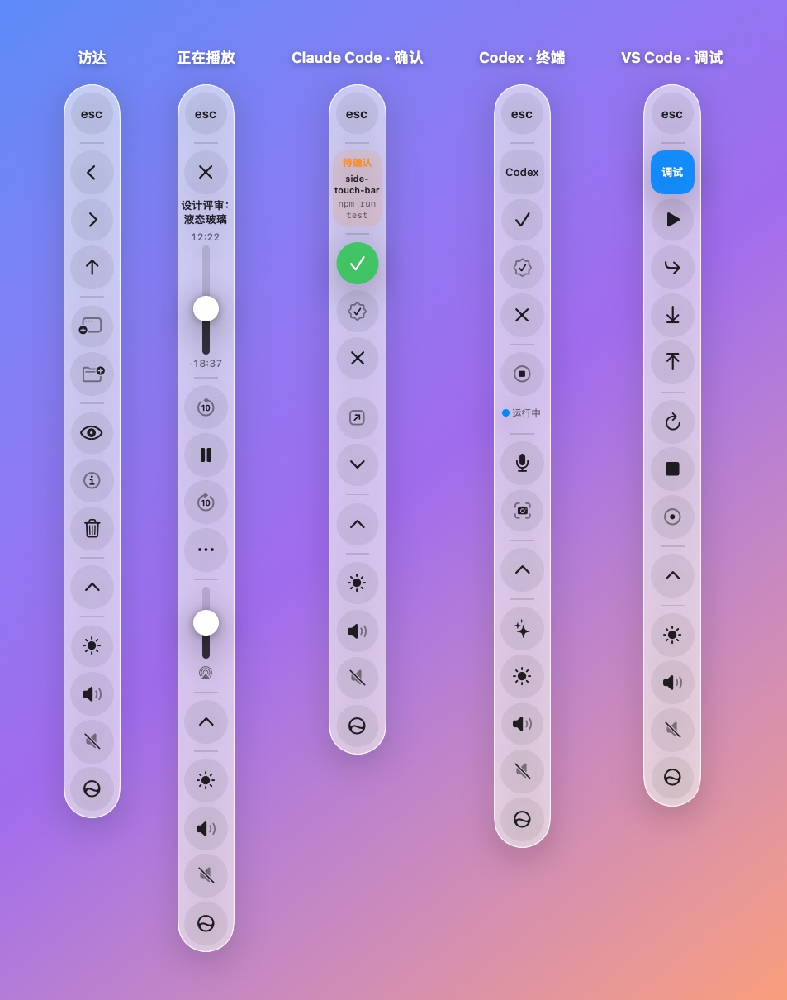
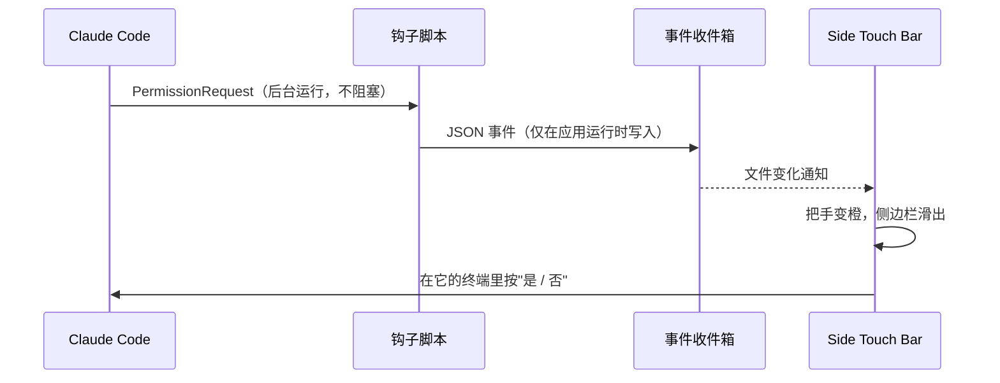
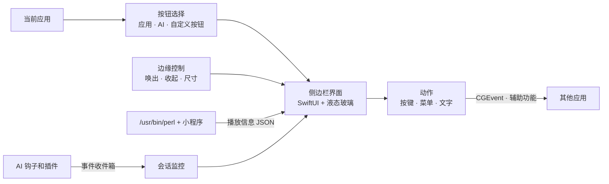

<div align="center">

# Side Touch Bar

**把 MacBook Touch Bar 竖过来，变成屏幕边缘的一条液态玻璃侧边栏。**

为将来的触屏 Mac 设计，现在用鼠标或触控板也能完整使用。

[](https://github.com/TwilightVoyager777/side-touch-bar/actions/workflows/ci.yml)
[](https://github.com/TwilightVoyager777/side-touch-bar/releases)


[](LICENSE)

[安装](#安装) · [功能](#功能) · [工作原理](#工作原理) · [常见问题](#常见问题) · [English](README.md)

<picture>
  <source media="(prefers-color-scheme: dark)" srcset="docs/images/preview-dark.zh.jpg">
  
</picture>

<sub>图片由应用自身的 SwiftUI 界面渲染，液态玻璃材质在图中为近似效果。</sub>

</div>

---

## 为什么做这个

在触屏笔记本上，屏幕底部是最不适合放按钮的位置：双手在键盘上，转轴挡着，一按屏幕就晃。屏幕两侧不一样：可以用手指从背面扶住屏幕，用拇指点按；而且 16:10 的屏幕横向有富余，不像底部那样占用宝贵的高度。

Side Touch Bar 把 Touch Bar 竖着放到了这里：从上到下是 **esc → 应用控件 → 控制条**。

## 亮点

- **还原 Touch Bar**：控制条、应用控件、按住 fn 显示 F 键、原版的显示模式和自定义。
- **跟随应用的按钮**：浏览器、编程工具、终端、苹果自带应用，其他应用也能自己加按钮。
- **统一样式的播放控件**：从浏览器里的视频到 IINA、Spotify 都一样。
- **为 AI 编程设计**：在侧边栏上直接确认 Claude Code 的请求，看到哪个 AI 在等你，按住说话写提示词。
- **为触屏设计**：8.8mm 的按钮、长按确认、按住连发、按住滑动调节、边缘手势。
- **原生、轻量**：Swift 和 SwiftUI 编写，不联网，隐藏时暂停后台工作。

## 安装

### 系统要求

| | |
|---|---|
| macOS | 26 Tahoe 或更高版本 |
| Mac | Apple 芯片或 Intel（通用版本） |
| 从源码构建 | 苹果命令行工具（`xcode-select --install`），不需要 Xcode |

### 下载

1. 在 [Releases](https://github.com/TwilightVoyager777/side-touch-bar/releases) 下载最新的 **SideTouchBar-x.y.z.dmg**，把 SideTouchBar 拖到"应用程序"。
2. 应用没有经过苹果公证，第一次打开会被拦下。先打开一次，再到 **系统设置 › 隐私与安全性** 点 **仍要打开**；或者运行：
   ```bash
   xattr -dr com.apple.quarantine /Applications/SideTouchBar.app
   ```
3. 按提示授予 **辅助功能** 权限。

### 从源码构建

```bash
git clone https://github.com/TwilightVoyager777/side-touch-bar.git
cd side-touch-bar
make install            # 构建、安装到"应用程序"（或 ~/Applications）并打开
```

### 卸载

```bash
make uninstall          # 或 scripts/uninstall.sh
```

卸载脚本会先移除装过的 AI 状态提醒（恢复你的 Claude Code、OpenCode、Codex 配置）和登录项，再删除应用、偏好设置、数据和已授予的权限。

## 快速上手

第一次启动时，**设置 › 开始** 会带你完成权限授权、界面语言（中文或英文）和登录时启动的设置。之后侧边栏停在主显示器的右侧边缘，平时只露出一条细把手。

| 操作 | 鼠标 | 触屏 |
|---|---|---|
| 唤出侧边栏 | 把指针移到屏幕边缘 | 从边缘往里滑，或点一下把手 |
| 收起侧边栏 | 移开指针（或等待） | 在栏上往外滑 |
| 调节亮度、音量 | 点一下打开滑条 | 按住图标上下拖动 |
| 连续调音量、缩放、快进… | 按住按钮 | 按住按钮 |
| 执行危险操作 | 按住 0.6 秒直到进度环填满 | 同左 |
| 显示 F1–F12 | 按住 **fn**（🌐） | 按住 **fn**（🌐） |

从菜单栏图标打开 **设置**（⌘,），可以选择侧边栏显示什么、自定义控制条、添加按钮和设置 AI 集成。

## 功能

### Touch Bar 基础功能

- **控制条**：默认是亮度、音量、静音、Siri；展开后是完整控制条（调度中心、启动台、键盘背光、媒体键）。可以从按钮库里选最多 6 个，包括截屏、锁屏、显示桌面、聚焦搜索、夜览、深色模式、输入法、表情、快捷指令、屏幕保护程序、睡眠。
- **触控栏显示**：应用控件与控制条、展开的控制条、应用控件、F1/F2 等键、快速操作（你的快捷指令）、空间。
- **fn 键**：按住 fn 显示 F 键（或其他页面），可以指定总是显示 F 键的应用。
- **表情滑条**：可滚动的表情列表，点一下输入到当前应用。

### 应用控件

按钮跟随当前应用变化，按钮多的应用分成几页，在应用控件顶部切换。

| 类别 | 应用 | 主要功能 |
|---|---|---|
| 浏览器 | Safari、Chrome、Arc、Edge、Firefox、Brave | 标签页列表、触控滚动区、缩放、查找、下载、阅读模式、开发者工具、常用网站 |
| 编程工具 | VS Code、Cursor、Windsurf、Zed、JetBrains 全系、Android Studio、Xcode | 运行、导航、编辑、Git、AI 几页；调试时自动切到调试页 |
| 终端 | 终端、iTerm2、Ghostty、Warp、kitty、WezTerm、Alacritty | 标签页、中断、清屏；运行 AI 时换成 AI 按钮 |
| AI 应用 | Claude、OpenCode、ChatGPT | 会话、搜索、侧边栏、终端、改动（通过菜单点击） |
| 苹果应用 | 访达、邮件、日历、预览、信息、备忘录、Pages、Keynote、计算器、照片 | Touch Bar 上熟悉的那些操作 |
| 其他应用 | — | 常用编辑操作，输入时显示文字编辑页 |

### 播放控件

当前应用播放视频或音乐时，应用控件会换成统一的播放器：封面、带已播放/剩余时间的进度条、播放按钮、音量、**倍速**、**全屏**、**画中画**、**字幕**、**随机/循环**，以及**音频输出切换**（扬声器、AirPods、显示器、AirPlay）。其他应用在后台播放时，控制条里会出现"正在播放"按钮，和原版 Touch Bar 一样。

### AI 编程

- **终端里的 AI**：运行 Claude Code、Codex、OpenCode 或 Gemini 时，侧边栏显示 **是 / 总是允许 / 否**、切换权限模式、语音输入、截图，以及一键输入的提示词和斜杠命令。
- **按住说话**：把说的话转成文字输入到当前应用，优先使用本机离线识别。
- **发送上下文**：把选中的代码（带文件路径）、当前网页或一块屏幕截图发给最近使用的 AI 工具。
- **状态提醒**：AI 等你确认时，边缘把手变成橙色；完成时变绿；运行中是蓝色。需要确认时侧边栏会自动滑出，顶部的卡片显示是哪个项目、要执行什么命令，下面是 **是 / 总是允许 / 否**，不用切换窗口就能回答；会话列表可以直接跳到对应的终端。Claude Code 还会用一个小圆环显示上下文用量。详见 [AI 状态提醒](#ai-状态提醒)。

### 触屏

- **长按确认**：锁屏、睡眠、删除、关闭标签页、Git 推送、"总是允许"。
- **按住连发**：音量、亮度、缩放、快进快退、撤销。
- **文字编辑页**：输入时出现，有 iPhone 那样的光标触控区、选择和按词开关、全选、删除一个词、拷贝、粘贴、撤销。
- **边缘手势**：滑入唤出、滑出收起。

### 自定义

- **自定义按钮**：给任意应用加按钮，可以从它的菜单里选、录一个快捷键，或者输入一段文字。
- **显示方式**：自动隐藏，或一直显示（在栏上往外滑可以临时收起）。
- **外观**：常规或清透玻璃，浅色、深色或跟随系统。
- **显示器**：主显示器、内建显示器或鼠标所在的显示器；小、标准、大三档尺寸。

## AI 状态提醒

集成是可选的，在 **设置 › AI 编程** 里按工具分别安装。每次安装都会说明具体改动、先备份要修改的文件，并且可以在同一个地方或用卸载脚本撤销。

| 工具 | 改动 |
|---|---|
| Claude Code 状态 | 在 `~/.claude/settings.json` 里给 9 个事件各加一条 `async` 后台命令 |
| Claude Code 上下文用量 | 包装 `statusLine`，你原来的状态栏照常输出 |
| OpenCode 状态 | 新建 `~/.config/opencode/plugins/sidetouchbar.js`，不改你的配置 |
| Codex 完成提醒 | 在 `~/.codex/config.toml` 加一行 `notify`（已有时不修改） |



## 权限与隐私

| 权限 | 是否必需 | 用途 |
|---|---|---|
| 辅助功能 | 是 | 发送快捷键和媒体键、点击菜单项、识别 fn 键、读取浏览器标签页和输入框状态 |
| 麦克风、语音识别 | 否 | 按住说话 |
| 屏幕录制 | 否 | 截图发给 AI |

Side Touch Bar **不发送任何网络请求**，唯一的例外是你从常用网站里主动打开的链接。设置保存在应用的偏好设置里；AI 状态提醒用的事件放在 `~/Library/Application Support/SideTouchBar` 下的一个小文件夹里。

> [!NOTE]
> 部分功能依赖系统私有接口或非官方方式，以后的 macOS 版本可能会改变。因此本应用不能通过 Mac App Store 分发。
> - **正在播放**：macOS 15.4 起，MediaRemote 只向苹果签名的程序提供信息，所以应用在系统自带的 `/usr/bin/perl` 里运行一个小程序（`Helpers/NowPlayingHelper.m`）来读取播放信息。
> - **亮度、键盘背光、夜览、深色模式、空间**：使用私有框架（DisplayServices、CoreBrightness、SkyLight），不可用时退回到模拟按键。

## 工作原理



- **边缘面板**：不抢焦点的浮动面板，点侧边栏不会打断你正在用的应用。
- **动作**：优先通过辅助功能按名称点击菜单项，不怕应用改快捷键；找不到时再发送按键。
- **尺寸**：按显示器的物理尺寸换算，让按钮在任何屏幕上都保持 14/16 寸 MacBook Pro 上的 44pt ≈ 8.8mm；并测量每个页面最高的状态，放不下就整体缩小而不是被切掉。
- **省电**：侧边栏隐藏时，菜单检查、输入框检查、AI 识别和音量读取都会暂停。

## 兼容性

| 显示器 | 按钮大小 |
|---|---|
| 14/16 寸 MacBook Pro，默认分辨率 | 44pt · 8.8mm |
| 14/16 寸 MacBook Pro，"更多空间" | 52pt · 8.7mm |
| 14/16 寸 MacBook Pro，"更大字体" | 38–39pt · 8.7mm |
| 13 寸 MacBook Air | 44pt · 8.6mm |
| 27 寸外接显示器 | 37–38pt · 8.7mm |

运行 `.build/debug/SideTouchBar --sizing-report --verbose` 可以查看每种布局的具体数值。

## 常见问题

<details>
<summary><b>macOS 提示无法打开应用。</b></summary>

发布的版本没有经过公证。先打开一次，再到 **系统设置 › 隐私与安全性** 点 **仍要打开**，或运行 `xattr -dr com.apple.quarantine /Applications/SideTouchBar.app`。
</details>

<details>
<summary><b>按钮点了没反应。</b></summary>

需要 **辅助功能** 权限（设置 › 开始 里可以看到状态）。更新应用后，系统可能要求重新授权：在辅助功能列表里删掉 SideTouchBar 再加回来，或运行 `tccutil reset Accessibility com.dest1ny.SideTouchBar`。
</details>

<details>
<summary><b>从源码构建，每次重新构建都要重新授权。</b></summary>

运行一次 `scripts/create-signing-identity.sh`。它会创建一个本机自签名证书，`build-app.sh` 之后会自动使用，重新构建的应用会被系统认作同一个应用。
</details>

<details>
<summary><b>播放控件没有出现。</b></summary>

播放器需要向 macOS 报告正在播放的内容（大多数都会，包括浏览器、音乐、Spotify、IINA、QuickTime）。读取这些信息依赖 [权限与隐私](#权限与隐私) 里提到的方式，以后的 macOS 可能会封掉。
</details>

<details>
<summary><b>按住 fn 没反应。</b></summary>

很多第三方键盘在键盘内部处理 fn 键，不会通知系统。苹果的键盘没有这个问题。
</details>

<details>
<summary><b>没有触屏能用吗？</b></summary>

能。所有功能都可以用鼠标或触控板操作：把指针移到屏幕边缘就会唤出侧边栏。
</details>

<details>
<summary><b>怎么给我常用的应用加按钮？</b></summary>

在 **设置 › 按钮** 里从应用的菜单选、录一个快捷键或输入文字。想让所有人都能用，可以添加预设并提交 Pull Request，详见 [CONTRIBUTING.md](CONTRIBUTING.md)。
</details>

## 路线图

- [ ] 诊断页，可导出报告
- [ ] 旁白（VoiceOver）支持；遵循"减弱动态效果"和"降低透明度"
- [ ] 终端里按标签页识别 AI
- [ ] 设置和自定义按钮的导入导出
- [ ] 经过公证的发布版本和应用图标
- [ ] 更多应用的实测预设（欢迎反馈）

## 参与贡献

欢迎提交问题、更多应用的预设和翻译。开发环境、约定和测试方法见 [CONTRIBUTING.md](CONTRIBUTING.md)。

## 致谢

- 灵感来自苹果的 Touch Bar 和它的控制条。
- 图标来自 [SF Symbols](https://developer.apple.com/sf-symbols/)。

## 许可证

基于 [MIT 许可证](LICENSE) 发布。
